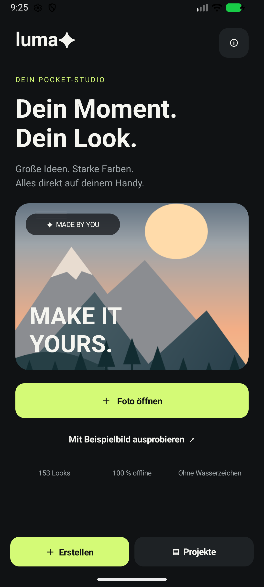
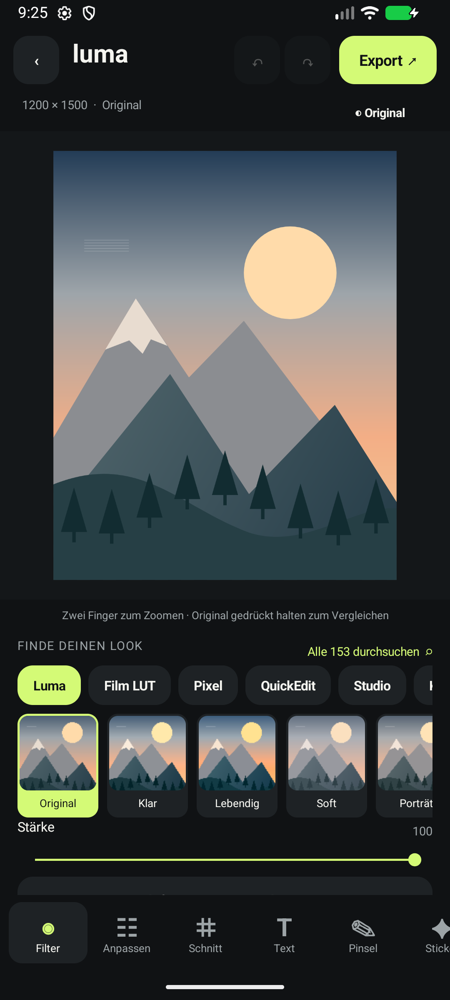

# luma ✦

**Dein Moment. Dein Look.**

Ein Bildstudio für Android: Fotos bearbeiten, Looks kombinieren, Text und Sticker gestalten und das Ergebnis direkt auf dem Handy speichern.

**Finale App: 1.0.1 · Android 9+ · 153 Looks · Offline · Ohne Wasserzeichen**

[APK herunterladen](https://github.com/Dirtyx686/Luma/releases/download/v1.0.1/Luma-1.0.1.apk) · [Version 1.0.1](https://github.com/Dirtyx686/Luma/releases/tag/v1.0.1) · [Bedienung](docs/BEDIENUNG.md)

## Ein Blick in die App

<table>
  <tr>
    <th>Startseite</th>
    <th>Bildbearbeitung</th>
  </tr>
  <tr>
    <td align="center"></td>
    <td align="center"></td>
  </tr>
  <tr>
    <td>Foto öffnen oder das integrierte Beispiel ausprobieren.</td>
    <td>Look auswählen, Stärke einstellen und Werkzeuge unten wechseln.</td>
  </tr>
</table>

Die Abbildungen zeigen die vorhandene Android-App mit dem integrierten Beispielbild.

## Was Luma kann

| Bereich | Funktionen |
| --- | --- |
| Looks und Filter | 153 auswählbare Looks einschließlich Original; Filtervorschau, Suche und stufenlose Stärke |
| Bildanpassung | Helligkeit, Kontrast, Sättigung, Wärme, Vignette und Filmkorn |
| Filter kombinieren | Einen Look in die Bildbasis übernehmen und anschließend einen weiteren anwenden |
| Zuschnitt | Freier Ausschnitt, Formatvorlagen, Drehen um 90° und horizontales Spiegeln |
| Text | Verschiebbare Textebenen mit Größe, Drehung, Farbe, vier Schriftfamilien, Fett/Kursiv und mehreren Zeilen |
| Kreative Werkzeuge | 32 Emoji-Sticker, Pinsel mit Farbe und Größe sowie drei Rahmen |
| Ebenen und Projekte | Text-/Sticker-Ebenenverwaltung, Rückgängig/Wiederholen, automatischer lokaler Entwurf und benannte Projektkopien |
| Export | PNG oder JPG mit wählbarer Ausgabegröße und JPG-Qualität; Speichern und Android-Teilen |

Die 153 Katalogeinträge setzen sich aus 40 Luma-Looks, 17 Film-LUTs, 39 PixelPerfect-Kurven, 24 QuickEdit-ACV-Looks, 23 PhotoEditor-MediaEffect-Presets und 10 kreativen Effekten zusammen.

## Installieren und loslegen

1. [Luma-1.0.1.apk herunterladen](https://github.com/Dirtyx686/Luma/releases/download/v1.0.1/Luma-1.0.1.apk).
2. Die APK auf einem Android-Gerät ab Android 9 öffnen. Bei Bedarf die Installation für die verwendete Browser- oder Dateien-App erlauben.
3. Luma starten und **Foto öffnen** oder **Mit Beispielbild ausprobieren** wählen.
4. Unten ein Werkzeug öffnen, das Bild bearbeiten und oben **Export** antippen.
5. PNG/JPG und Ausgabegröße wählen, anschließend speichern oder teilen.

Fotos werden gezielt über die Android-Dateiauswahl geöffnet. Die App benötigt keinen allgemeinen Zugriff auf die Fotobibliothek. Sie läuft ohne Konto und ohne Netzwerkberechtigung; Entwürfe und Projekte werden lokal gespeichert.

Eine ausführliche Schrittfolge und Hinweise zu den Werkzeugen stehen in der [Bedienungsanleitung](docs/BEDIENUNG.md).

## Bildqualität und Grenzen

- Beim Import wird die lange Bildkante auf höchstens **2560 Pixel** begrenzt. Der Export vergrößert diese Arbeitsbasis nicht.
- Rückgängig/Wiederholen umfasst bis zu 16 Schritte, abhängig vom verfügbaren Speicher. Die Historie wird beim erneuten Öffnen eines Projekts nicht wiederhergestellt.
- Kombinierte Filter werden in die Bildbasis übernommen. Texte und Pinsel bleiben editierbar.
- Der Funktionsumfang umfasst Fotobearbeitung mit Filtern, Text und Stickern. KI-Generierung, automatisches Freistellen, RAW-Entwicklung, PSD/PSB, Videobearbeitung und Cloud-Synchronisation sind nicht enthalten.
- MediaEffect-Ergebnisse können je nach Android-Gerät und Grafiktreiber leicht variieren.

## Download und Version

Dieses Repository stellt die finale **Luma 1.0.1** mit Bildern, Bedienungsanleitung und APK bereit. Die SHA-256-Prüfsumme der APK steht in [SHA256SUMS.txt](docs/releases/SHA256SUMS.txt).

## Lizenzhinweise

Die Lizenz- und Herkunftshinweise der verwendeten Drittanbieter-Bestandteile stehen in [LIZENZEN.txt](docs/LIZENZEN.txt) und in der App unter ⓘ.
